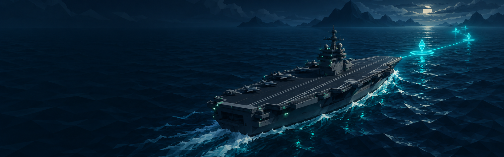
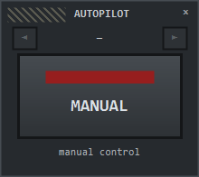
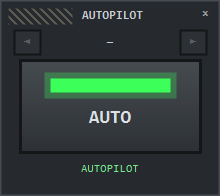
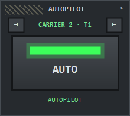
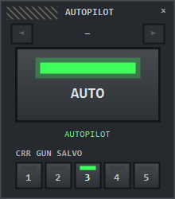

<p align="center">
  
</p>

<h1 align="center">CC2 Autopilot</h1>

<p align="center">
  <b>A one-button autopilot for your carrier in <i>Carrier Command 2</i>.</b><br>
  Plot waypoints on the map, press <b>AUTO</b> — the carrier sails the route by itself and stops at the last point.
</p>

<p align="center">
  <a href="#download">Download</a> ·
  <a href="#how-it-works">How it works</a> ·
  <a href="#launch-together-with-the-game-steam">Steam setup</a> ·
  <a href="#faq">FAQ</a> ·
  <a href="#русский">Русский</a>
</p>

---

## What it does

Carrier Command 2 already contains a capable autopilot: it is the same AI helmsman that drives the
computer-controlled carriers. The game simply never lets the player switch it on.

**CC2 Autopilot** is a tiny desktop panel that flips that switch for *your* carrier:

| Manual | Autopilot | Multiplayer host: pick the carrier | With the optional salvo row |
|:---:|:---:|:---:|:---:|
|  |  |  |  |

- **AUTO** — the carrier follows the waypoints you placed on the map, in order, and **stops at the last one**.
- **MANUAL** — the helm is yours again, exactly as in the vanilla game.
- Works with **any save, any game state** — the panel finds your carrier by itself after every launch and load.
- Starts and closes **together with the game** if you add one line to Steam launch options.
- **Multiplayer (host):** if your team has several carriers, pick the one you want with **◄ ►** at the top
  of the panel — *CARRIER 2 · T1* is carrier no. 2 of team 1 (the same number the *Revolution* mod shows
  in brackets on its pause-menu map).
- *(Optional, off by default)* **Main gun salvo 1–5** — how many shells the carrier main gun fires per
  support-fire request (vanilla is 5). Single-player only, see [Fair play](#fair-play).

No game files are modified. Nothing is installed. Close the panel and the game is exactly vanilla again.

## Download

1. Grab the latest `CC2Autopilot-vX.Y.zip` from the **[Releases](../../releases)** page.
2. Unzip it anywhere (for example `Documents\CC2Autopilot`).
3. Run `CC2Autopilot.exe` — a small panel appears in the bottom-right corner of the screen.

Requirements: Windows 10/11 (64-bit) with .NET Framework 4.x (already part of Windows). No admin rights needed.

> **Antivirus warning.** The program is not code-signed and it changes the memory of another program —
> exactly what antivirus heuristics dislike. Windows SmartScreen may ask *“Run anyway?”*, and some
> antiviruses may flag it. The full source code is in this repository: read it or build it yourself
> (see [Build from source](#build-from-source)).

## How to use

1. Start the game and load any save.
2. Open the map and place waypoints for your **carrier** as usual.
   In multiplayer with several player carriers, first choose the carrier with **◄ ►** on the panel.
3. Make sure the **steering lock** and **side thrusters** are off and the engine is running.
4. Click the big button on the panel → the lamp turns **green, AUTO**. The carrier sails the route.
5. Click again → **MANUAL**, the helm is yours.

The panel can be dragged anywhere. Right-click it for options: *Always on top*, *Main gun salvo
(single-player only)*, *Exit*.

> **Note:** the auto mode is stored in the save. If you save while the autopilot is on, the carrier
> will continue sailing by itself after loading — the lamp will be green, just click to turn it off.

## Launch together with the game (Steam)

Steam → Library → right-click **Carrier Command 2** → **Properties** → **General** → **Launch options**:

```
"C:\path\to\CC2Autopilot.exe" %command%
```

Now the regular **Play** button starts the panel, the panel starts the game, and the panel closes a few
seconds after you quit. To undo, clear the field.

## How it works

For the curious (and for the sceptical):

- Each vehicle in CC2 has a `control_mode` field: `0 = auto`, `1 = manual`. AI carriers are always `0`,
  the player carrier is `1`. Flipping the player carrier to `0` hands it to the built-in AI helmsman,
  which follows the carrier's own waypoints.
- Even single-player CC2 runs a server and a client in one process. The panel finds the **server-side**
  vehicle object (the one the simulation uses) using the field layout from the game's own save code,
  checks the class pointer, vehicle id and team, and writes one integer. That's the whole trick.
- In multiplayer the server runs only in the **host's** game. That's why the panel works for the host
  (for any carrier of any team) and cannot work for clients: a client's game has no server objects, and
  there is no game command a client could send to switch the mode.
- The Lua modding API can only *read* the control mode, which is why this is a small external program and
  not a Steam Workshop mod.
- The salvo option changes the in-memory value of `turret_carrier_main_gun_salvo_count`, a constant
  from `rom_0/scripts/constants.txt`.

**Safety rules built into the panel**

- It never writes unless it finds the server object of the selected carrier (class pointer + vehicle id + team).
- If several player carriers are in manual mode (multiplayer host), it does nothing until you pick one
  with ◄ ► in this session — a carrier remembered from an earlier game is never switched silently.
- It only touches your carrier's control mode and, if you enable it, the salvo constant. Nothing else.

## Fair play

- The **autopilot** does not change combat — it only steers.
- The **salvo** option does change combat, so it is **off by default** and labelled *single-player only*.
  Please don't use it against other people without their agreement.
- In multiplayer only the host can use it. As the host, please switch other players' carriers only when they ask you to.

## Compatibility

Tested with Carrier Command 2 Steam build `23836745` (`carrier_command.exe`, 11 353 600 bytes,
PE timestamp 2026-06-20). Works alongside the *Revolution* overhaul mod. A game update may move things
in memory; in that case the panel simply says *“no carriers — not the host?”* and writes nothing.
Multiplayer tested as the host with two carriers in one team.

## Build from source

No IDE needed — the C# compiler ships with Windows:

```
build.cmd
```

or manually:

```
C:\Windows\Microsoft.NET\Framework64\v4.0.30319\csc.exe -nologo -target:winexe -platform:x64 -out:build\CC2Autopilot.exe src\CC2Autopilot.cs
```

The whole program is a single file: [`src/CC2Autopilot.cs`](src/CC2Autopilot.cs).

## FAQ

**The carrier doesn't move.** Check that it has waypoints, the engine is on, the steering lock and side
thrusters are off. Then click the panel once more — it re-scans memory on every click.

**Does the helm override the autopilot?** No. While AUTO is on, the AI helmsman owns the carrier. Click the panel to get the helm back.

**Is this a Workshop mod?** No. Workshop mods are Lua and data files, and Lua cannot switch the control mode.

**Multiplayer: the panel says “no carriers — not the host?”.** This usually means you joined someone
else's game. The autopilot lives on the host's machine — ask the host to run CC2 Autopilot and switch
your carrier. If you are the host, check that a game is loaded; an unsupported game update can also
prevent the panel from finding the carrier.

**Will I get banned?** CC2 has no anti-cheat that we know of, and the autopilot gives no combat
advantage. Still, use it at your own risk.

## Disclaimer

Not affiliated with or endorsed by Geometa or the game's publisher. *Carrier Command 2* is a trademark of its
respective owners. Provided “as is”, without warranty — see [LICENSE](LICENSE).

---

## Русский

**CC2 Autopilot** — автопилот для вашего авианосца в *Carrier Command 2* одной кнопкой.

В игре уже есть автопилот: это тот самый «робот-капитан», который водит авианосцы компьютера. Игроку его
просто не дают включить. Маленькая панель на рабочем столе включает его для **вашего** авианосца:

- **AUTO** — авианосец идёт по точкам маршрута, поставленным на карте, по порядку и **останавливается на последней**;
- **MANUAL** — штурвал снова ваш, как в обычной игре;
- работает с любым сохранением и в любом состоянии игры — панель сама находит авианосец;
- **сетевая игра (хост):** если в команде несколько авианосцев, выберите нужный стрелками ◄ ► вверху
  панели — *CARRIER 2 · T1* значит авианосец №2 команды 1 (тот же номер Revolution пишет в скобках на
  карте в меню паузы). Клиент (не хост) включить автопилот не может: сервер игры работает у хоста;
- *(по желанию, выключено по умолчанию)* **залп главного калибра 1–5** — сколько выстрелов делает пушка
  авианосца по запросу огня поддержки (в игре 5). Только для одиночной игры.


**Как пользоваться.** Запустите игру, поставьте авианосцу точки на карте, выключите блокировку руля и
боковые подруливающие, нажмите большую кнопку — лампа станет зелёной, **AUTO**. Ещё раз — **MANUAL**.
Правая кнопка мыши по панели — настройки и выход.

**Запуск вместе с игрой.** Steam → Библиотека → правой кнопкой по игре → Свойства → Общие →
Параметры запуска: `"C:\путь\к\CC2Autopilot.exe" %command%`.

**Важно.** Файлы игры не меняются, программа меняет только одно-два значения в памяти запущенной игры.
Антивирус может ругаться: программа без цифровой подписи и работает с памятью другой программы. Весь
исходный код открыт в этом репозитории. Если сохраниться с включённым автопилотом, после загрузки
авианосец продолжит идти сам — выключается той же кнопкой.

Проект не связан с Geometa и издателем игры.
